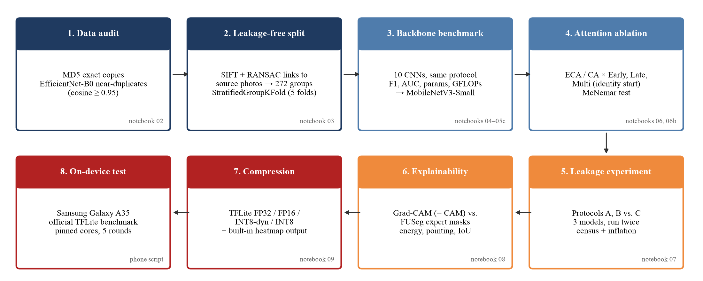

# DFU-LiteNet

**Lightweight, explainable diabetic foot ulcer classification with leakage-free evaluation**

B.Sc. thesis (CSE-4800), Department of Computer Science and Engineering, International Islamic University Chittagong (IIUC), 2026.
Mohammad Ariful Islam · Sadhon Kumar Dev · Md. Azad Hossan Munna — supervised by Mr. Mohammad Mahadi Hassan.

DFU-LiteNet is a phone-sized CNN that tells diabetic foot ulcer skin from healthy skin, shows where it looked (Grad-CAM), and runs offline on an Android phone. Every result is measured on a **leakage-free** split, because the public dataset contains many duplicate images.



## Key results

| Finding | Result |
| --- | --- |
| Duplicates in the public Kaggle DFU dataset | 342 of 1,055 files (32.4%) are exact copies; 713 unique images remain |
| Leakage of a careless random split | 84.9% of test images have a copy or a patch of the same photo in training (ours: 0%) |
| Selected backbone (10-model benchmark) | MobileNetV3-Small: F1 99.3 ± 0.8%, 0.94 M parameters, 0.12 GFLOPs |
| Attention (ECA, Coordinate Attention; early, late, multi-stage) | No significant improvement (all McNemar p ≥ 0.18) |
| Leakage inflation | Not significant for pretrained models; up to +2.3 F1 points for a CNN trained from scratch |
| Grad-CAM vs. expert ulcer masks (FUSeg, 986 crops) | 29.0% of heatmap energy on the ulcer vs. 5.6% for chance; pointing game 94.9% |
| TensorFlow Lite FP16 | 1.93 MB, identical predictions to FP32 |
| Samsung Galaxy A35 (Exynos 1380) | 4.7 ms per image on one fast core, 1.9 ms on four; heatmap included |

All numbers are means over 5 leakage-free test folds (713 images) unless stated otherwise.

## Repository layout

```
notebooks/        Kaggle notebooks, one per step (01-09), run in order
data/             splits.csv (the leakage-free 5-fold split), duplicate table, SIFT links
results/          result tables (CSV) and figures from every notebook
models/           TensorFlow Lite models of fold 0 (FP32, FP16, INT8-dyn, INT8) + thresholds
android-app/      source of the Android demo app (Java, LiteRT)
phone-benchmark/  script and results of the on-phone latency test
figures/          figures used in the thesis
```

| Notebook | Step |
| --- | --- |
| 01 | Explore the Kaggle DFU dataset |
| 02 | Find exact copies (MD5) and near-duplicates (EfficientNet-B0 similarity) |
| 03 | Link patches to their source photos (SIFT + FLANN + RANSAC) and build the leakage-free 5-fold split |
| 04 | Pipeline check on one fold |
| 05, 05b, 05c | Ten-model backbone benchmark and backbone selection |
| 06, 06b | Attention ablation: ECA and Coordinate Attention at early, late and multi-stage positions |
| 07 | Leakage experiment: careless vs. de-duplicated vs. leakage-free split (run twice; run 1 in `results/07-leakage-experiment-run1`) |
| 08 | Grad-CAM evaluated against FUSeg expert masks |
| 09 | TensorFlow Lite conversion (FP32, FP16, INT8) with a built-in heatmap output |

## Reproducing the results

1. **Data.** The images are not included here. Download the [Kaggle DFU dataset](https://www.kaggle.com/datasets/laithjj/diabetic-foot-ulcer-dfu) by Alzubaidi et al. Notebook 08 downloads FUSeg from the [official challenge repository](https://github.com/uwm-bigdata/wound-segmentation).
2. **Run the notebooks on Kaggle** in numeric order with a GPU (we used an NVIDIA T4, TensorFlow 2.21, Keras 3.13). Attach the dataset, and attach the output of earlier notebooks where a notebook asks for it (for example, notebook 05 onwards reads `splits.csv` from notebook 03).
3. **Use our split directly.** `data/splits.csv` has one row per file: `class`, `file`, `label`, `md5`, `group`, `matched_photo`, `keep` (one file per exact copy) and `fold` (0-4). In run *k*, fold *k* is the test set and fold *(k+1) mod 5* the validation set.

GPU training is not bit-for-bit repeatable, so retrained numbers can differ slightly. The leakage experiment was therefore run twice, and only findings that agree across both runs are claimed.

Correction: the first Kaggle run of notebook 05c reported a wrong GFLOPs value for ConvNeXt-Tiny. The notebook is fixed; see `notebooks/05c-ten-model-benchmark/CORRECTIONS.md`.

## Android demo app

The app classifies a skin photo as ulcer or healthy, shows the Grad-CAM heatmap and the inference time, and runs fully offline with the FP16 model.

- **Install:** download `DFU-LiteNet-demo.apk` from this repository's **Releases** page and open it on an Android phone (Android 9 or newer; allow installing from unknown sources).
- **Build:** `cd android-app && ./gradlew assembleDebug` with JDK 17 and the Android SDK (platform 34). Set `sdk.dir` in `android-app/local.properties`.

The model was trained on close-up skin patches, so photos should be close-ups of the skin area.

## Limitations

The dataset is small (713 unique patches), comes from one source and has two classes. The DFUC 2020/2021 datasets were not used, because their licence could not be obtained during the project. This is a research prototype for screening support, **not a medical device or a diagnosis tool**.

## Citation

```
M. A. Islam, S. K. Dev, and M. A. H. Munna, "DFU-LiteNet: A Benchmark-Driven, Explainable and Lightweight
CNN for Diabetic Foot Ulcer Classification with Leakage-Free Evaluation," B.Sc. thesis, Dept. of CSE,
International Islamic University Chittagong, 2026.
```

## Licence

The code in this repository is released under the MIT Licence (see `LICENSE`). The Kaggle DFU and FUSeg datasets keep their own licences and are not redistributed here; only a few example images appear in the figures and in the demo app, for illustration, with credit to the dataset authors.
